<p align="center"></p>

# Akhbaar

An AI news intelligence platform. Akhbaar collects headlines by category, shows each reader only the topics they chose, and uses a large language model to give a three point summary, a plain English explanation and a sentiment label for any article on request.

Built as a B.Tech CSE major project at KIIT. Project lead: [Prakhar Pragyan](https://github.com/prakharpragyan).

**Live app:** https://akhbaar-gules.vercel.app  
**API:** https://akhbaar-api.onrender.com/api (free Render instance, the first request after idle can take about 15 seconds)

## Contents

[Features](#features) · [Screenshots](#screenshots) · [Architecture](#architecture) · [Tech stack](#tech-stack) · [Getting started](#getting-started) · [API](#api) · [How it works](#how-it-works) · [Deployment](#deployment) · [Test results](#test-results) · [Known issues](#known-issues) · [Team](#team)

## Features

- **Accounts and security.** Register and login with bcrypt hashed passwords (12 rounds) and 7 day JWT sessions. Protected routes on both client and server.
- **Personalised feed.** Pick topics at sign up (technology, business, science, health, sports, entertainment, top stories) and change them later on the Interests page.
- **Search, bookmarks and trending.** Search cached articles, save articles to your account, and see the ten most read articles.
- **Recommendations.** Click counts feed a "Recommended" tab that favours the categories you read most and hides articles you already opened.
- **AI reading help.** AI Summary (3 bullets), ELI5 (explain like I am five) and a sentiment label, all through the Groq API, with results cached in MongoDB.
- **Resilient by design.** News is cached for 30 minutes. If NewsAPI fails or blocks the host, the server serves stale cache, then built in fallback articles, so users do not see server errors.
- **Responsive UI.** React, Tailwind CSS and loading skeletons, from phone to desktop.

## Screenshots

| Personalised feed | Trending |
| --- | --- |
| 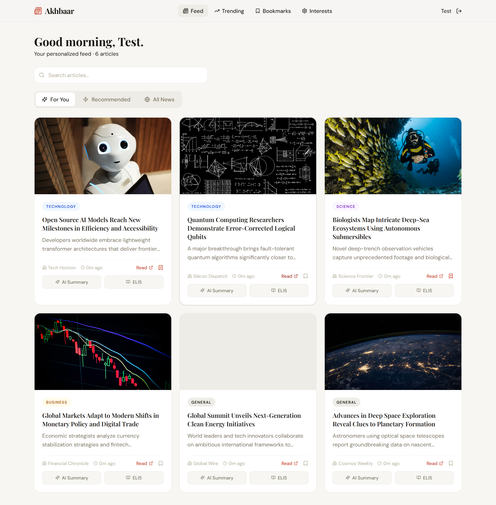 | 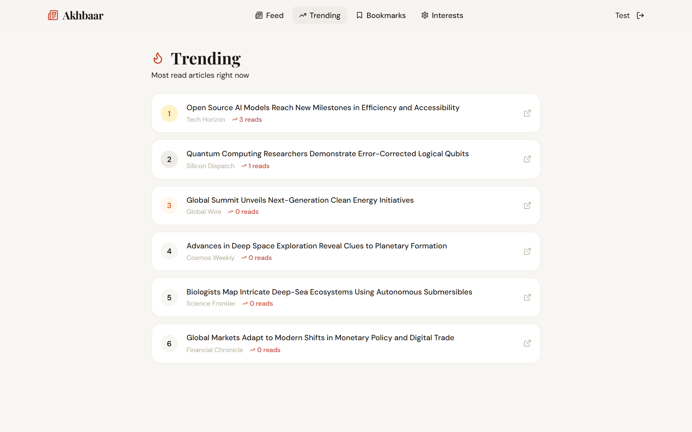 |

| Login | Bookmarks | Mobile |
| --- | --- | --- |
| 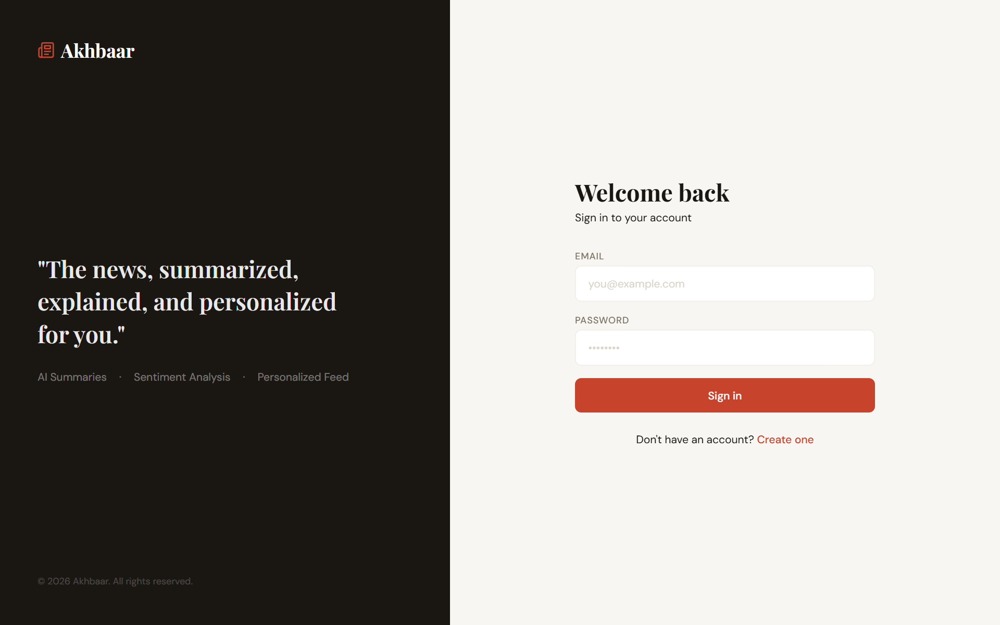 | 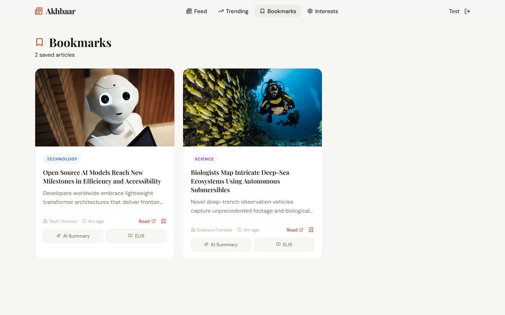 | 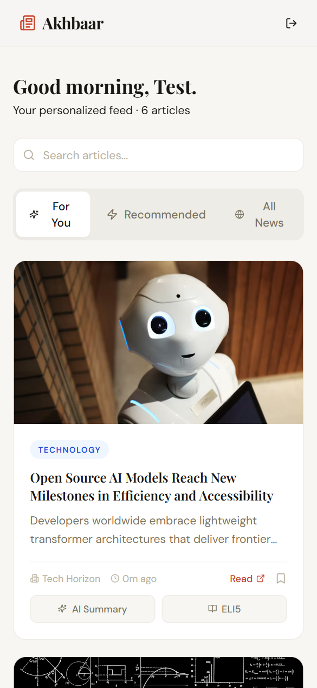 |

## Architecture

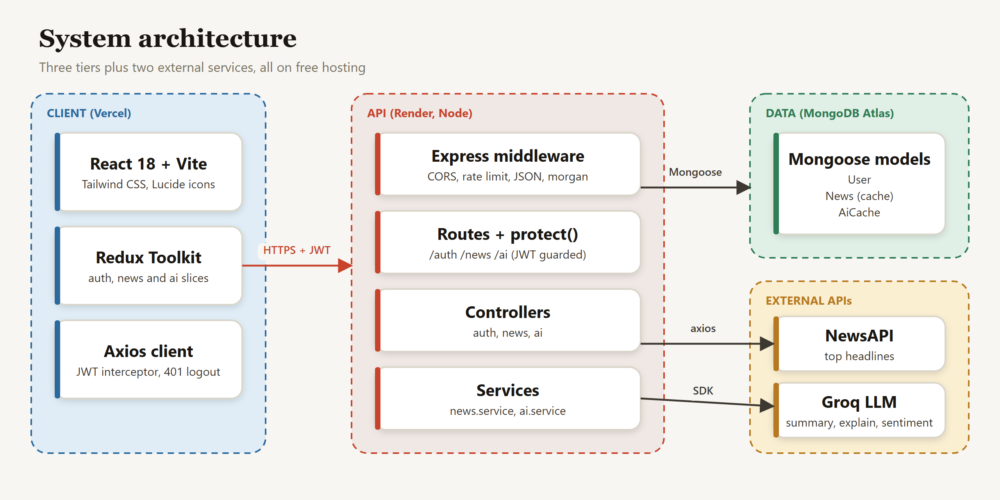

Routes map URLs to controllers, controllers hold the request logic, and services hold the calls to NewsAPI and Groq. A global error handler turns Mongoose, validation and JWT errors into clean JSON.

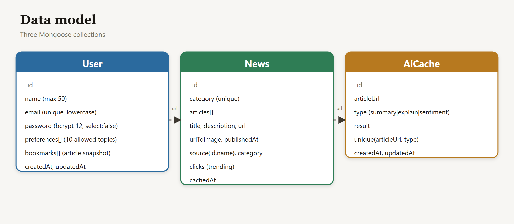

## Tech stack

| Layer | Tools |
| --- | --- |
| Front end | React 18, Vite, Tailwind CSS, Lucide icons |
| State and HTTP | Redux Toolkit (auth, news, ai slices), Axios with a JWT interceptor |
| API | Node.js, Express 4, CORS, express-rate-limit, morgan |
| Database | MongoDB Atlas, Mongoose 8 |
| Security | bcryptjs, jsonwebtoken |
| External APIs | NewsAPI (top headlines), Groq (chat completions) |
| Hosting | Vercel (client), Render (API), MongoDB Atlas (data) |

## Getting started

Requirements: Node.js 18+ and a MongoDB connection string (local or Atlas). A [NewsAPI](https://newsapi.org) key and a [Groq](https://console.groq.com) key are optional: without a NewsAPI key the server serves fallback articles, and without a Groq key the AI routes return a 503 message.

```bash
git clone https://github.com/prakharpragyan/Akhbaar.git
cd Akhbaar
```

### Server

```bash
cd server
npm install
# create server/.env with the values below
npm run dev
```

Server `.env`:

```
MONGO_URI=mongodb://localhost:27017/akhbaar
JWT_SECRET=change_me
JWT_EXPIRES_IN=7d
PORT=5000
CLIENT_URL=http://localhost:5173
NEWS_API_KEY=your_newsapi_key
GROQ_API_KEY=your_groq_key
GROQ_MODEL=qwen/qwen3.8-27b
```

Never commit `.env`. It is gitignored.

### Client

```bash
cd client
npm install
npm run dev
```

Open http://localhost:5173. The client calls `http://localhost:5000/api` by default. Set `VITE_API_URL` in `client/.env` to point at another API.

### Run from VS Code

Use `Tasks: Run Task` then `Run All`, or the `Run Full Stack` launch configuration (see `.vscode/`). Both start the server and the Vite client.

## API

All routes except register, login and health need an `Authorization: Bearer <token>` header.

| Method | Path | Purpose |
| --- | --- | --- |
| GET | `/api/health` | Health check |
| POST | `/api/auth/register` | Create an account |
| POST | `/api/auth/login` | Sign in, returns a JWT |
| GET | `/api/auth/me` | Current user |
| PUT | `/api/auth/preferences` | Save topic interests |
| GET | `/api/news?category=` | Cached headlines for one category |
| GET | `/api/news/personalized` | Articles for all selected interests |
| GET | `/api/news/search?q=` | Search cached articles (2+ characters) |
| GET | `/api/news/trending` | Ten most clicked articles |
| GET | `/api/news/recommendations` | Click based picks |
| POST | `/api/news/click` | Record a read |
| POST | `/api/news/bookmark` | Toggle a bookmark |
| GET | `/api/news/bookmarks` | List bookmarks |
| POST | `/api/ai/summarize` | Three bullet summary |
| POST | `/api/ai/explain` | Simple explanation |
| POST | `/api/ai/sentiment` | positive, negative or neutral |

Rate limits: `/api/auth` allows 30 requests per 15 minutes per IP, `/api/news` and `/api/ai` allow 500 per 5 minutes.

## How it works

### Cache first news retrieval

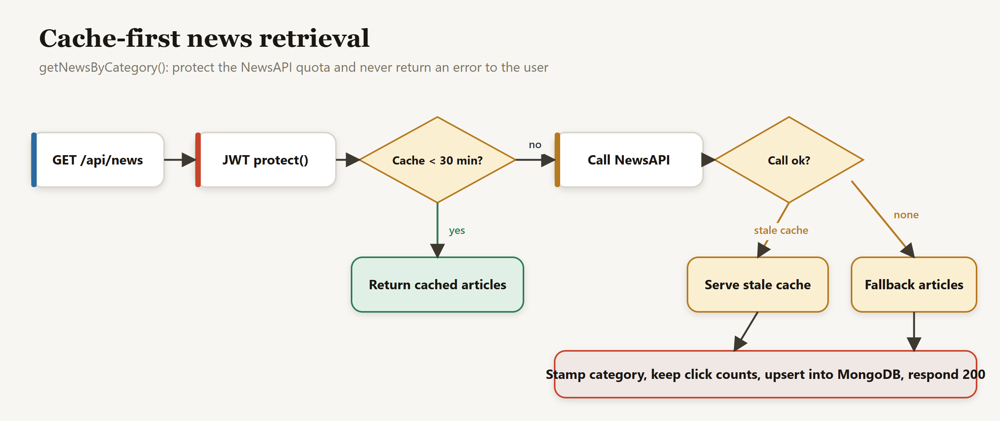

### AI pipeline with a response cache

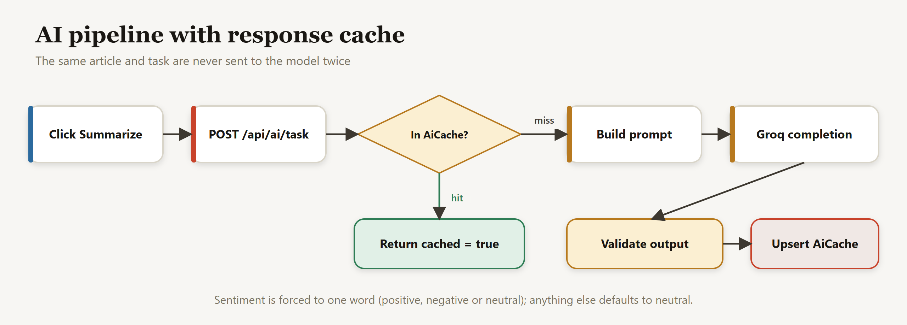

Each answer is stored by article URL and task type, so the model is called once per article and task. Sentiment replies are reduced to one word and default to neutral.

## Deployment

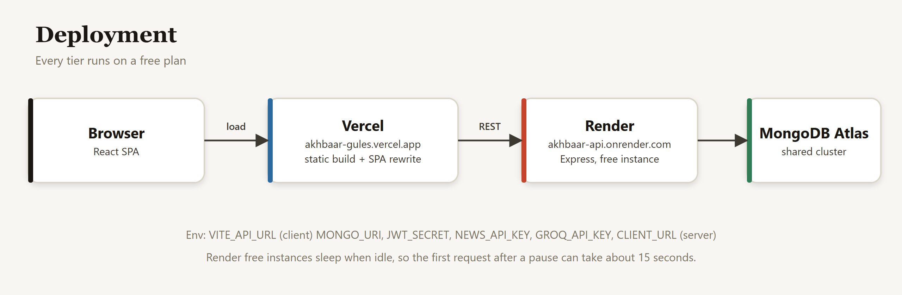

- **Client on Vercel.** `client/vercel.json` rewrites every path to the single page app. Set `VITE_API_URL` to the Render API URL.
- **API on Render.** Set `MONGO_URI`, `JWT_SECRET`, `NEWS_API_KEY`, `GROQ_API_KEY` and `CLIENT_URL`. The server trusts the Render proxy and allows the Vercel origin through CORS.
- Render free instances sleep when idle, so the first request after a pause can be slow.

## Test results

An automated script of 27 HTTP checks was run against the API on a local machine with an in memory MongoDB. All 27 returned the expected status code. They cover validation, duplicate accounts, token protection, the click, trending, search and bookmark flow, cache hit and miss, and error handling. The AI route was checked only for input validation and the 503 response, because no Groq key was set during the run, so AI output quality is not evaluated here.

News endpoint timing, cache miss (fallback path) against cache hit:

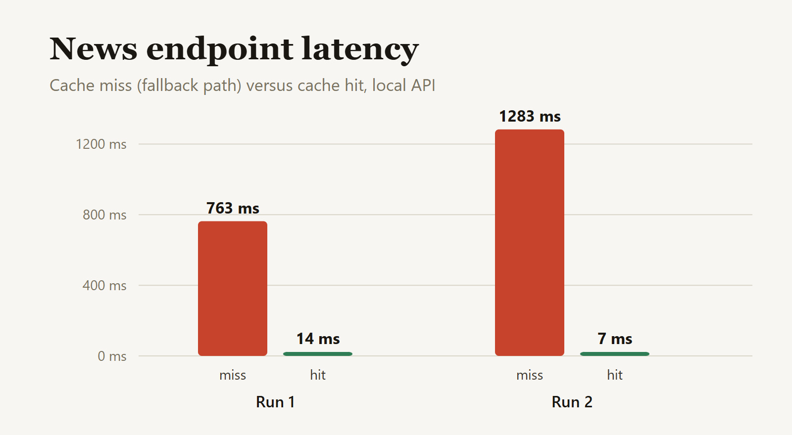

## Known issues

- The strict auth limiter (30 per 15 minutes) is mounted on all of `/api/auth`, so it also counts `GET /api/auth/me`, which the client calls on every page load. After repeated sign ins and reloads the API can answer 429 "Too many attempts". Applying the strict limiter to login and register only would fix this.
- The feed asks for a sentiment label for every card, which is many AI calls per load. The AI cache and the 500 request limit absorb this, but a lazy or batched call would be lighter.
- Recommendation scores are shared across all users, not per user.

## Team

Project lead: **Prakhar Pragyan**.

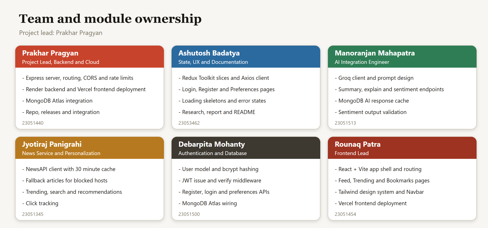

| Member | Roll No. | Role | What they own |
| --- | --- | --- | --- |
| Prakhar Pragyan ([prakharpragyan](https://github.com/prakharpragyan)) | 23051440 | Project Lead, Backend and Cloud | Express server, routing, CORS and rate limits; Render and Vercel deployment; MongoDB Atlas integration; repo and integration |
| Rounaq Patra | 23051454 | Frontend Lead | React and Vite app shell and routing; Feed, Trending and Bookmarks pages; Tailwind design system and Navbar; Vercel frontend deployment |
| Debarpita Mohanty | 23051500 | Authentication and Database | User model and bcrypt hashing; JWT issue and verify middleware; register, login and preferences APIs; MongoDB Atlas wiring |
| Manoranjan Mahapatra | 23051513 | AI Integration Engineer | Groq client and prompt design; summary, explain and sentiment endpoints; MongoDB AI response cache; sentiment output validation |
| Jyotiraj Panigrahi | 23051345 | News Service and Personalization | NewsAPI client with 30 minute cache; fallback articles for blocked hosts; trending, search and recommendations; click tracking |
| Ashutosh Badatya | 23053462 | State, UX and Documentation | Redux Toolkit slices and Axios client; Login, Register and Preferences pages; loading skeletons and error states; research, report and README |

## Contributing

Fork, create a branch, make your changes, test locally and open a pull request.

## License

MIT

## Credits

- [NewsAPI](https://newsapi.org) for headlines and [Groq](https://groq.com) for fast model inference
- [React](https://react.dev), [Redux Toolkit](https://redux-toolkit.js.org), [Express](https://expressjs.com), [Mongoose](https://mongoosejs.com), [Vite](https://vitejs.dev) and [Tailwind CSS](https://tailwindcss.com)
